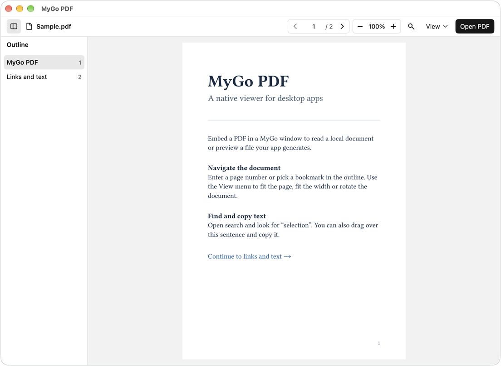

# MyGo PDF

[简体中文](README.zh-CN.md)

MyGo PDF is a native, read-only PDF viewer you can embed in a [MyGo](https://github.com/egoist/mygo) desktop app. Use it to preview a PDF your app generates or to build a reader with your own toolbar. Refreshing a document preserves the reading position while the new pages render.



- Continuous scrolling, pointer-centered zoom, fit modes and high-DPI rendering.
- Page navigation, bookmarks, text search, rotation, text selection, copying and links.
- In-memory PDFs and local files, with password retries and accessible page content where the PDF permits it.

## Try the viewer

Install [mise](https://mise.jdx.dev/), then clone and run the example.

```sh
git clone https://github.com/gvenusleo/mygo-pdf.git
cd mygo-pdf
mise trust
mise run dev
```

The [example](examples/viewer) opens a bundled two-page PDF. Use **Open PDF** to try a local file. Choose **View > Hide toolbar** to see the embedded view on its own. Press `Cmd`+`P` on macOS or `Ctrl`+`P` on Windows and Linux to show the toolbar again.

## Embed the viewer

Import `github.com/gvenusleo/mygo-pdf/pdf` in your MyGo app. Create one viewer on the window's UI thread, load your PDF bytes and call `View` from the window's content callback.

```go
viewer := pdf.NewViewer(window, pdf.Options{})
viewer.LoadBytes(ctx, data, pdf.OpenDocument)

// In the window's ui.View callback:
viewer.View(c.Key("pdf"), nil)
```

Run the host with `mygo dev` or package it with `mygo build` so MyGo includes PDFium and its license notices. The [integration guide](docs/en/usage.md) shows how to add the package to an existing app and covers file ownership, refreshes and password retries.

## Requirements

| Component | Requirement |
| --- | --- |
| Toolchain | Go and MyGo. See [`go.mod`](go.mod) for the project requirements. |
| Desktop | macOS 13 or later, Windows and glibc Linux |
| Architectures | amd64 and arm64 on each platform |

## Documentation and help

- [Integration guide](docs/en/usage.md) for embedding and packaging the viewer.
- [Development guide](docs/en/development.md) for testing, contributing and releases.
- [Design](docs/en/design.md), [performance measurements](docs/en/performance.md) and [roadmap](docs/en/plan.md).
- [GitHub Issues](https://github.com/gvenusleo/mygo-pdf/issues) for bug reports and feature requests.

## License

[MIT](LICENSE). Portions based on MyGo are covered by the [MyGo contributor license](resources/pdfium-mygo-LICENSE.txt). PDFium and third-party notices ship with the native library.
