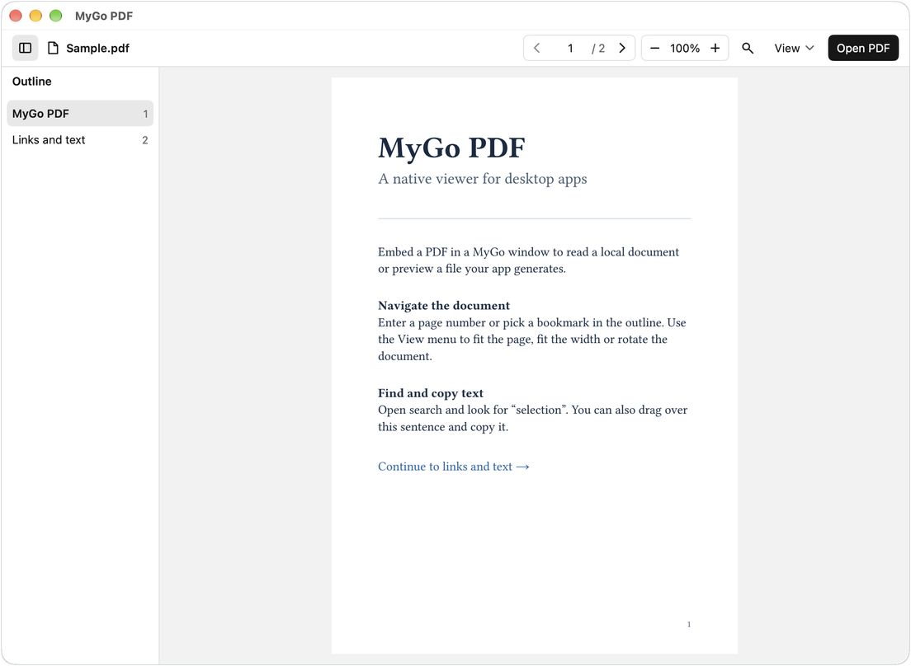

# MyGo PDF

[English](README.md)

MyGo PDF 是可嵌入 [MyGo](https://github.com/egoist/mygo) 桌面应用的原生只读 PDF 查看器。可以用它预览应用生成的 PDF，也可以搭配自己的工具栏做成阅读器。刷新同一份文档时，查看器会保留阅读位置，等新页面渲染完成再更新画面。



- 连续滚动、围绕指针缩放、页面适配和高 DPI 渲染。
- 页码跳转、书签、文本搜索、旋转、选字复制和链接。
- 支持内存中的 PDF 和本地文件，可重试密码，并按文档权限提供无障碍内容。

## 运行示例

安装 [mise](https://mise.jdx.dev/) 后，克隆仓库并运行示例。

```sh
git clone https://github.com/gvenusleo/mygo-pdf.git
cd mygo-pdf
mise trust
mise run dev
```

[示例应用](examples/viewer)启动时会打开内置的两页 PDF。点击 **Open PDF** 可以试读本地文件。在 **View** 菜单中选择 **Hide toolbar**，可以查看单独嵌入时的效果。macOS 上按 `Cmd`+`P`，Windows 和 Linux 上按 `Ctrl`+`P` 可恢复工具栏。

## 嵌入 MyGo 应用

在 MyGo 应用中导入 `github.com/gvenusleo/mygo-pdf/pdf`。在窗口的 UI 线程创建查看器并传入 PDF 字节，再在窗口的内容回调中调用 `View`。

```go
viewer := pdf.NewViewer(window, pdf.Options{})
viewer.LoadBytes(ctx, data, pdf.OpenDocument)

// In the window's ui.View callback:
viewer.View(c.Key("pdf"), nil)
```

用 `mygo dev` 运行宿主应用，或用 `mygo build` 打包，MyGo 会一并准备 PDFium 和许可证声明。[接入指南](docs/zh-CN/usage.md)说明如何给现有应用添加依赖、嵌入查看器、关闭文件、刷新和重试密码。

## 环境要求

| 项目 | 要求 |
| --- | --- |
| 工具链 | 需要 Go 和 MyGo，项目要求见 [`go.mod`](go.mod)。 |
| 桌面平台 | macOS 13 或更高版本、Windows 和使用 glibc 的 Linux |
| 架构 | 各平台均支持 amd64 和 arm64 |

## 文档与反馈

- [接入指南](docs/zh-CN/usage.md)介绍嵌入和打包方式。
- [开发指南](docs/zh-CN/development.md)介绍测试、贡献和发布流程。
- [设计文档](docs/zh-CN/design.md)、[性能实测](docs/zh-CN/performance.md)和[路线图](docs/zh-CN/plan.md)。
- 在 [GitHub Issues](https://github.com/gvenusleo/mygo-pdf/issues) 报告问题或提出功能建议。

## 许可

项目采用 [MIT 许可证](LICENSE)。源自 MyGo 的部分保留 [MyGo 贡献者的许可声明](resources/pdfium-mygo-LICENSE.txt)。PDFium 和第三方许可随动态库分发。
